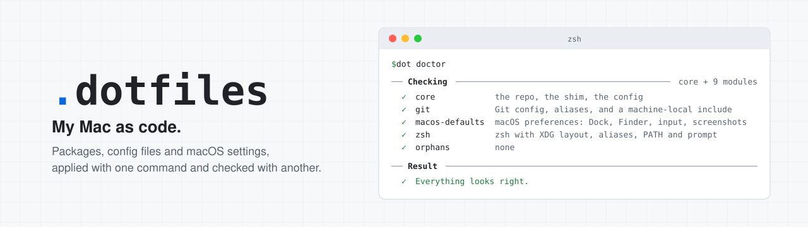

<p align="center">
  
</p>

<p align="center">
  <a href="https://github.com/martinzachariassen/dotfiles/actions/workflows/ci.yml"></a>
  <a href="LICENSE"></a>
</p>

<p align="center">
  <a href="#quick-start"><b>Quick start</b></a>
  &nbsp;·&nbsp;
  <a href="#modules"><b>Modules</b></a>
  &nbsp;·&nbsp;
  <a href="#documentation"><b>Documentation</b></a>
  &nbsp;·&nbsp;
  <a href="docs/uninstall.md"><b>Uninstall</b></a>
</p>

Homebrew packages, config files symlinked into `$HOME`, and the few macOS
settings that are not files at all, described in one repo. `dot apply` makes a
machine match it, and `dot doctor` tells you, without changing anything,
whether it still does.

This is my own setup. It is public so you can read it, borrow from it, or fork
it and make it yours.

## Quick start

You need an Apple Silicon Mac running macOS 14 or newer. Nothing else has to be
installed first.

**1. Run the installer.**

```sh
curl -fsSL https://raw.githubusercontent.com/martinzachariassen/dotfiles/main/install.sh | bash
```

It installs the Xcode Command Line Tools, Homebrew and bash 5, and clones this
repo to `~/Developer/personal/dotfiles`.

**2. Pick your modules.** A first-run wizard asks which parts of the repo this
machine should have and writes your answer to `~/.config/dotfiles/config.toml`.
From then on, `dot apply` applies it.

**3. Check the result.** `dot doctor` should end with *Everything looks right.*

> **Forking it?** Edit the `[user]` table in [`profiles.toml`](profiles.toml)
> first. The wizard copies that name, noreply email and public signing key into
> your config without asking, so a fork run as-is authors commits as Martin and
> turns on signing with a key whose private half lives only in his 1Password
> vault.

## What it does

| | |
| --- | --- |
| **Installs packages** | Homebrew, with one `Brewfile` per module plus a small core every machine gets. |
| **Links config files** | Symlinks into `$HOME`, so editing `~/.config/git/config` edits the file in this repo. |
| **Runs module hooks** | For what a symlink cannot do: macOS `defaults`, a generated git include, a `jq` merge into `~/.claude/settings.json`. |
| **Reports drift** | `dot doctor` is read-only. A healthy module is one line; a broken one expands to say what. It also names packages installed by hand that no `Brewfile` would put on your next machine. |
| **Takes it back** | [`uninstall.sh`](docs/uninstall.md) removes what the repo added and never a file of yours. |

A healthy machine looks like this:

```
── Checking ─────────────────────────────────────────────── core + 9 modules
  ✓ core           the repo, the shim, the config
  ✓ apps           GUI apps and fonts as casks, plus an opened-once check
  ✓ claude-code    Claude Code CLI and its status line
  ✓ cmux           cmux terminal config -- Option key stays native macOS input
  ✓ containers     Docker via colima (a Linux VM, no Docker Desktop)
  ✓ dev-cli        Development CLI tools, plus mise-managed language runtimes
  ✓ git            Git config, aliases, and a machine-local include
  ✓ macos-defaults macOS preferences: Dock, Finder, input, screenshots
  ✓ ssh            SSH client config; keys come from the 1Password agent
  ✓ zsh            zsh with XDG layout, aliases, PATH and prompt
  ✓ orphans        none
  → unmanaged      4 packages no Brewfile names
        Formula fd
        Formula goreleaser
        Formula poppler
        Cask curseforge
        add one to a module Brewfile and the next machine gets it too.

── Result ──────────────────────────────────────────────────────────────────
  ✓ Everything looks right.
```

Two promises hold the rest together:

- **Nothing deletes a real file.** A file in the way is moved to
  `~/.local/state/dotfiles/backups/`, and that tree is never removed.
- **Dry run and real run print the same words.** `--dry-run` is the real code
  path with every mutating step turned into a `printf`, so the preview is what
  happens.

## Commands

```
dot apply              Install packages, link configs, run module hooks
dot apply --dry-run    Show every intended change, make none
dot add <module>       Enable one module and apply it
dot remove <module>    Undo one module and disable it
dot config             Open the config file in $EDITOR
dot config --init      Create it for the first time (runs the wizard)
dot doctor             Check this machine; read-only
dot doctor --verbose   The same, including every check that passed
```

`add` and `remove` take `--dry-run` too. Re-running `dot apply` is safe and
expected.

<details>
<summary><strong>Updating</strong></summary>

```sh
git -C ~/Developer/personal/dotfiles pull && dot apply
```

This updates the *configuration*, not the packages. `apply` runs `brew bundle
--no-upgrade`, so a package a Brewfile gained arrives and a newer version of one
you already have does not. Upgrading is `brew upgrade`, on your schedule.

</details>

<details>
<summary><strong>Configuration</strong></summary>

Everything you choose lives in `~/.config/dotfiles/config.toml`, generated once
by the wizard and yours from then on: your name and email, the list of enabled
modules, and a `[settings.<module>]` table for modules that take options.

Edit it and run `dot apply`, or let `dot add` and `dot remove` edit the module
list for you. They change one line and leave every other byte, comments
included, alone. See [docs/configuration.md](docs/configuration.md).

</details>

## Modules

A module is a directory under [`modules/`](modules/). Enable the ones you want;
the rest stay out of the way.

### Tool modules

These manage a tool's configuration and install the tool as well, so a module
is never half-enabled.

| Module | What it manages |
| --- | --- |
| `git` | [config, aliases, and a generated machine-local include](modules/git/README.md) |
| `ssh` | [client config; keys stay in 1Password's agent](docs/modules.md#ssh-and-commit-signing) |
| `zsh` | [XDG layout, aliases, PATH, `$EDITOR`, starship](modules/zsh/README.md), and API keys as 1Password references |
| `cmux` | the terminal, plus the Ghostty config it reads: Option stays native for Æ/Ø/Å |
| `claude-code` | [the CLI, and keys merged into `~/.claude/settings.json`](modules/claude-code/README.md) |
| `containers` | [Docker via colima](modules/containers/README.md), no Docker Desktop |
| `dev-cli` | [CLI tools and mise-managed language runtimes](modules/dev-cli/README.md) |
| `macos-defaults` | [Dock, Finder, keyboard, screenshots, locale units](modules/macos-defaults/README.md), set imperatively with no files at all |
| `apps` | [GUI casks and fonts](modules/apps/README.md): Raycast, Chrome, VS Code and more, plus which of them have never been opened |

### Package sets

A Brewfile and nothing else: tools this repo installs but does not configure.

| Module | What it installs |
| --- | --- |
| `work-apps` | what an employer's machine needs: Intune, Office, Teams, Slack |
| `dotfiles-dev` | the toolchain `make check` runs, for a machine you develop *this repo* on |

> **Heads up:** [`macos-defaults`](modules/macos-defaults/README.md) is the one
> module nothing can undo. The old values were never read, so they exist
> nowhere, and removing the module names the settings it wrote rather than
> putting them back.

## Documentation

| Document | What is in it |
| --- | --- |
| [Architecture](docs/architecture.md) | The three phases, the link engine, the orphan scan, and why there is no state file |
| [Configuration](docs/configuration.md) | `config.toml`, enabling and disabling modules, profiles, logs and exit status |
| [Modules](docs/modules.md) | The module contract, writing one, and SSH and commit signing |
| [Uninstalling](docs/uninstall.md) | What `uninstall.sh` removes, what it keeps, and why casks go first |
| [Development](docs/development.md) | `make check`, the structural limits CI enforces, and reading a crash |

Design rules for each directory live in its `CLAUDE.md`:
[`lib/`](lib/CLAUDE.md) · [`bin/`](bin/CLAUDE.md) · [`core/`](core/CLAUDE.md) ·
[`modules/`](modules/CLAUDE.md) · [`tests/`](tests/CLAUDE.md).

## Development

```sh
make check     # shellcheck, shfmt, bats
```

That is the whole list, and exactly what CI runs. Its tools are the
`dotfiles-dev` module rather than part of the core, so install them with
`brew bundle --file modules/dotfiles-dev/Brewfile`. See
[docs/development.md](docs/development.md).

<details>
<summary><strong>Project layout</strong></summary>

```
bin/dot          The CLI: dispatches each verb
lib/             The shared library: config, filesystem, Homebrew, output, wizard
core/            What every machine gets: a Brewfile and its apply/doctor hooks
modules/         One directory per module: Brewfile, home/, hooks, README
tests/           bats suites, plus contract.bats for the repo's structural rules
docs/            The longer explanations linked above
install.sh       The bootstrap, run before the repo exists
uninstall.sh     Takes everything back
profiles.toml    Wizard presets: your identity and the module profiles
```

</details>

## Contributing

Fork freely. This is a personal setup rather than a tool built for others, so
pull requests are not expected, but you are welcome to take whatever is useful.

## License

[MIT](LICENSE)
