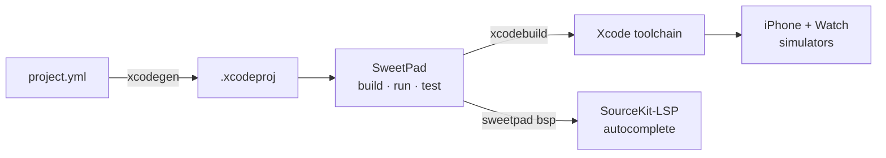

# ios

Repo: [dotfiles](../../README.md) · The module contract:
[docs/modules.md](../../docs/modules.md)

iPhone and Apple Watch apps, written in VS Code. Xcode is installed because its
SDKs, simulators, `xcodebuild` and `lldb-dap` exist nowhere else, but it is
not the editor: nothing in the daily loop below opens it.

| Job | Tool |
|---|---|
| Build, run, simulators, devices, tests | [SweetPad](https://sweetpad.hyzyla.dev) extension (`sweetpad.sweetpad`) |
| Autocomplete (its build server) and debugging (`sweetpad dap`, Xcode's lldb-dap) | `sweetpad` CLI, from `sweetpad-dev/tap` |
| Swift language support, SwiftPM, test explorer | [Swift](https://marketplace.visualstudio.com/items?itemName=swiftlang.swift-vscode) extension (`swiftlang.swift-vscode`) |
| The `.xcodeproj`, generated from YAML | [XcodeGen](https://github.com/yonaskolb/XcodeGen) |
| Formatting | `swift-format`, bundled with Xcode; SweetPad's default |
| Linting | [SwiftLint](https://github.com/realm/SwiftLint), as a build plugin per project, and as a CLI once Xcode is installed |
| Readable build logs | `xcbeautify`, which SweetPad pipes through when it is installed |
| Installing and switching Xcode | [xcodes](https://github.com/XcodesOrg/xcodes), with `aria2` for parallel downloads |
| Swift in Claude Code: diagnostics, go-to-definition | the `swift-lsp` plugin (`swift-lsp@claude-plugins-official`), on Xcode's `sourcekit-lsp` |



## First time on a machine

```sh
dot add ios                                          # packages, extensions, swift-lsp, ~/.swift-format
xcodes install --latest --select --experimental-unxip  # Apple ID + sudo; 10+ GB
dot apply                                            # now fetches the iOS and watchOS simulators
dot doctor
```

## Not automatic

**Xcode itself.** `xcodes` needs an Apple ID with two-factor sign-in, and
selecting the result needs `sudo`; neither belongs in a run that should finish
unattended. `apply.sh` warns until Xcode is selected and does nothing else on
its behalf. `xcodes install --select` also accepts the licence and runs the
first-launch step, which is why there is no separate `xcodebuild -license` line
here.

**The SweetPad CLI's tap is trusted in the Brewfile.** Homebrew refuses a
formula from a third-party tap until someone trusts it. `trusted: true` on that
one line trusts that one formula, not the rest of `sweetpad-dev/tap`.

**The `swiftlint` CLI waits for Xcode.** Homebrew will not install it with only
the Command Line Tools, so its Brewfile line applies only once an
`/Applications/Xcode*.app` exists. From then on `doctor` reports it missing
until the next `dot apply`.

**The simulators wait for Xcode.** Once one is selected, `apply.sh` runs
`xcodebuild -downloadPlatform iOS` and `watchOS` for whichever runtime is
missing. That is several gigabytes each, and it is announced before it starts.

**The Claude Code plugin waits for `claude`.** The CLI comes from the
`claude-code` module, and a module cannot depend on another, so without it
`apply.sh` says the plugin waits and moves on. With it, `apply.sh` runs
`claude plugin install <id> --scope user` for each line of
`data/claude-plugins` that `~/.claude/plugins/installed_plugins.json` does not
list at user scope. Writing `enabledPlugins` into `~/.claude/settings.json`
would not do: that only declares a plugin, it never installs one. The official
marketplace registers itself on the first interactive `claude` session, so on
a fresh machine run `claude` once before `dot apply`. Disabling the plugin
with `/plugin` is left alone; only an uninstalled one is put back.

## A new project

These four files are the whole setup. Nothing about them is global, and the
next section says why.

`project.yml`, one iPhone app with its Watch app inside it:

```yaml
name: Hello
options:
  bundleIdPrefix: com.example
  defaultSourceDirectoryType: syncedFolder
  deploymentTarget:
    iOS: "26.0"
    watchOS: "26.0"
packages:
  SwiftLintPlugins:
    url: https://github.com/SimplyDanny/SwiftLintPlugins
    from: 0.65.0
targets:
  Hello:
    type: application
    platform: iOS
    sources: [Hello]
    settings:
      PRODUCT_BUNDLE_IDENTIFIER: com.example.hello
      GENERATE_INFOPLIST_FILE: YES
      INFOPLIST_KEY_UILaunchScreen_Generation: YES
    dependencies:
      - target: HelloWatch
    buildToolPlugins:
      - plugin: SwiftLintBuildToolPlugin
        package: SwiftLintPlugins
    scheme:
      testTargets: [HelloTests]
  HelloWatch:
    type: application
    platform: watchOS
    sources: [HelloWatch]
    settings:
      PRODUCT_BUNDLE_IDENTIFIER: com.example.hello.watchkitapp
      GENERATE_INFOPLIST_FILE: YES
      INFOPLIST_KEY_WKCompanionAppBundleIdentifier: com.example.hello
    buildToolPlugins:
      - plugin: SwiftLintBuildToolPlugin
        package: SwiftLintPlugins
    scheme: {}
  HelloTests:
    type: bundle.unit-test
    platform: iOS
    sources: [HelloTests]
    dependencies:
      - target: Hello
```

The Watch app's bundle identifier has to start with the iPhone app's, or the
iPhone app will not embed it. With `syncedFolder`, a new `.swift` file needs
no regenerate; only a change to `project.yml` does.

`.vscode/settings.json`:

```json
{
  "[swift]": {
    "editor.defaultFormatter": "sweetpad.sweetpad",
    "editor.formatOnSave": true
  },
  "sweetpad.build.args": ["-skipPackagePluginValidation"]
}
```

`-skipPackagePluginValidation` is what lets `xcodebuild` run the SwiftLint
plugin without first clicking "Trust & Enable" in Xcode's GUI.

`.vscode/launch.json`, so F5 builds, launches and attaches:

```json
{
  "version": "0.2.0",
  "configurations": [
    { "type": "sweetpad-lldb", "request": "launch", "name": "SweetPad: Build and Run" }
  ]
}
```

`.swiftlint.yml`, at least the exclusions, or SwiftLint lints the build
output:

```yaml
excluded:
  - .build
  - DerivedData
```

Then:

```sh
xcodegen generate     # or: SweetPad: Generate an Xcode project using XcodeGen
code .
```

In SweetPad's sidebar, pick the `Hello` scheme and an iPhone simulator, then
build and run. Pick `HelloWatch` and a Watch simulator for the Watch app.
Lint warnings land in the Problems panel with the build. Tests run from
SweetPad's Tests view.

## Why the editor settings are per project

Your VS Code `settings.json` is JSONC you write by hand, comments included. No
tool here can merge a key into that without rewriting the file, and the repo
does not rewrite a file the user owns. So the module installs the two
extensions and leaves every setting to the project's `.vscode/settings.json`,
which is where SweetPad's own documentation puts them, and where a
collaborator who clones the project gets them too.

## `~/.swift-format`

swift-format looks for `.swift-format` in the file's directory and every
directory above it, so this one is the fallback for any project under `$HOME`
that has none of its own. It sets 4-space indentation and 100-column lines:
Xcode's indentation and your editor's ruler. swift-format's own default is 2
spaces, which would reformat every Xcode-generated file on its first save. The
file is plain JSON and swift-format accepts no comments in it, which is why
the reason lives here.

A project that commits its own `.swift-format` wins over this one, which is
what you want for anything shared.

## On a real iPhone or Apple Watch

SweetPad lists a connected device next to the simulators. A device needs
Developer Mode turned on (Settings > Privacy & Security), and the build needs
a signing team. A free Apple ID works for running on your own devices, and a
paid membership is only needed to ship. A Watch app installs through the
iPhone it is paired with.

## What `doctor` checks, and what `remove` does

`doctor.sh` checks the four things that fail without saying so:

- Xcode, not just the Command Line Tools, is the selected developer directory.
  `xcode-select -p` keeps printing a path after the app is deleted, so it also
  checks that `xcodebuild` exists there.
- An iOS and a watchOS simulator runtime are on disk. Without one, SweetPad
  simply lists no destination.
- Both extensions are installed in VS Code.
- `swift-lsp` is installed in Claude Code at user scope. Without it, Claude
  edits Swift blind and offers the plugin again. With no `claude` CLI at all it
  is not checked, and says so.

It reads all four from disk, never from `code`, `claude`, `xcodebuild` or
`simctl`: a tool asked a question can create the very state it reports on, and
a doctor never writes.

`dot remove ios` deletes nothing. Xcode, the runtimes, the extensions and the
plugin are large or easy to use for something else, and nothing can tell which
of them this module put there, so it names what is left and the commands that
remove each:

| Left alone | Yours to run |
|---|---|
| the two VS Code extensions | `code --uninstall-extension <id>` |
| the `swift-lsp` Claude Code plugin | `claude plugin uninstall <id>` |
| iOS and watchOS simulator runtimes | `xcrun simctl runtime delete <id>` |
| Xcode | `xcodes uninstall <version>` |

It stays silent on a machine that has none of them.
